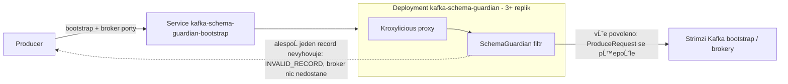
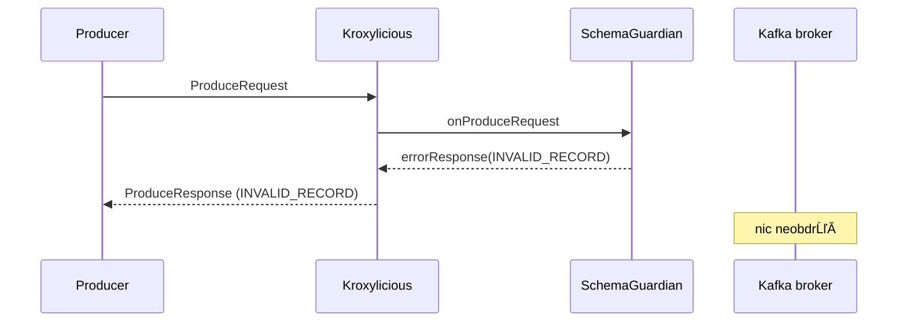

# kafka-schema-guardian

Kroxylicious filtr (Java 21), který kontroluje **každý Kafka `ProduceRequest`** dřív, než se dostane k brokeru.
Z každého recordu čte jen topic, délku hodnoty, *magic byte* a *schema ID* podle Confluent wire formátu. Cokoli,
co není explicitně povoleno v whitelistu `topic -> povolená schema ID`, se odmítne přímo v proxy a **broker o tom
požadavku nikdy neuslyší**.

* Žádná deserializace Avro/Protobuf/JSON, žádný Schema Registry lookup, žádné kopírování ani logování payloadu.
* Výchozí politika `DENY`, fail-closed: chyba konfigurace, výjimka při validaci nebo neočekávaná struktura požadavku
  nikdy neznamená propuštění zprávy.
* Samostatný, bezstavový Kubernetes Deployment před existujícím Strimzi clusterem (ne sidecar).

## Obsah

1. [Verze a kompatibilita](#1-verze-a-kompatibilita)
2. [Architektura a datovĂ˝ tok](#2-architektura-a-datovĂ˝-tok)
3. [ValidaÄŤnĂ­ algoritmus](#3-validaÄŤnĂ­-algoritmus)
4. [Chování vůči producerům](#4-chování-vůči-producerům)
5. [Konfigurace a whitelist](#5-konfigurace-a-whitelist)
6. [Výkon](#6-výkon)
7. [Logování a metriky](#7-logování-a-metriky)
8. [Build a testy](#8-build-a-testy)
9. [Docker image](#9-docker-image)
10. [Lokální testování](#10-lokální-testování)
11. [Kubernetes: Kustomize a Helm](#11-kubernetes-kustomize-a-helm)
12. [SĂ­tÄ›, Kafka metadata a Strimzi](#12-sĂ­tÄ›-kafka-metadata-a-strimzi)
13. [PLAINTEXT, TLS a mTLS](#13-plaintext-tls-a-mtls)
14. [Změna whitelistu, rollback](#14-změna-whitelistu-rollback)
15. [Dostupnost, škálování, nastavení producerů](#15-dostupnost-škálování-nastavení-producerů)
16. [CI/CD](#16-cicd)
17. [Troubleshooting](#17-troubleshooting)
18. [Bezpečnostní omezení a známé limitace](#18-bezpečnostní-omezení-a-známé-limitace)

---

## 1. Verze a kompatibilita

| Součást | Verze | Poznámka |
|---|---|---|
| Kroxylicious | **0.25.1** (vydáno 2026-10-20) | nejnovější stabilní verze v Maven Central; API ověřeno proti `kroxylicious-api-0.25.1` |
| Java | **21** | od Kroxylicious 0.22 je Java 21 minimum; testováno i na Java 25 upstreamem |
| Kafka message API | **4.3.x** | od 0.24 jsou třídy `*Data` vendorované do `io.kroxylicious.kafka.*`; `kafka.message-spec.version` Kroxylicious 0.25.1 je 4.3.0 |
| Kafka klienti v testech | 4.3.1 | stejná verze jako v Kroxylicious parent POM |
| Proxy image | `quay.io/kroxylicious/proxy:0.25.1` | pinnuto i digestem, viz [Dockerfile](Dockerfile) (`quay.io/kroxylicious/kroxylicious` je od 0.24 zrušený) |
| Strimzi | libovolná | proxy se připojuje jako běžný Kafka klient na TLS listener; fragmenty Strimzi CR v README jsou ilustrativní |

### Pravidla kompatibility pluginu

1. **Plugin se kompiluje proti přesné verzi Kroxylicious a musí běžet na stejné verzi.** `kroxylicious.version`
   v [pom.xml](pom.xml) a tag `PROXY_IMAGE` v [Dockerfile](Dockerfile) se mění vždy společně.
2. Filter API se mezi minor verzemi láme (0.24: přechod na `io.kroxylicious.kafka.*`, `errorResponse(..., Errors)`
   místo výjimek; 0.22: životní cyklus `FilterFactory` per virtual cluster). Aktualizace = změna verze, kompilace,
   unit testy a integraÄŤnĂ­ testy, teprve pak novĂ˝ image.
3. Plugin používá z balíku `io.kroxylicious.kafka.common.record.internal` třídy `MemoryRecords`, `Record`,
   `RecordBatch`. Upstream tento balík označuje jako **nepodporované API** (může se změnit i v patch verzi). Je to ale
   jediná cesta k dekomprimovaným recordům a používají ji i vestavěné filtry Kroxylicious (record validation, encryption).
   Proto pravidlo 1.
4. Všechny závislosti pluginu mají scope `provided`; JAR obsahuje jen vlastní třídy (`jackson`, `micrometer`, `slf4j`
   dodává proxy). Plugin se objeví přes `ServiceLoader`:
   [`META-INF/services/io.kroxylicious.proxy.filter.FilterFactory`](src/main/resources/META-INF/services/io.kroxylicious.proxy.filter.FilterFactory)
   obsahuje `cz.company.guardian.SchemaGuardian`; v konfiguraci se používá jako `type: SchemaGuardian`.
5. Instance `FilterFactory` je od 0.22 vytvářena **pro každý virtual cluster zvlášť**; whitelist se proto načítá
   per virtual cluster a metriky jsou sdílené přes globální Micrometer registry proxy.

---

## 2. Architektura a datovĂ˝ tok



OdmĂ­tnutĂ­:



* Producer se připojuje na `kafka-schema-guardian-bootstrap`, ne na Strimzi bootstrap Service.
* Kroxylicious přepisuje adresy brokerů v `Metadata` odpovědích (`portIdentifiesNode`), takže po bootstrapu klient
  mluví opět s proxy, nikoli přímo s brokerem. Detaily v [kapitole 12](#12-sítě-kafka-metadata-a-strimzi).
* Guardian je **první** filtr v `defaultFilters`: nic nesmí projít jiným filtrem ani k brokeru, dokud ho neschválí.
* Replika neudržuje žádný stav kromě načteného neměnného whitelistu. Všechny repliky čtou stejný ConfigMap.

---

## 3. ValidaÄŤnĂ­ algoritmus

Implementace: [`RequestValidator`](src/main/java/cz/company/guardian/validation/RequestValidator.java) a
[`RecordChecker`](src/main/java/cz/company/guardian/validation/RecordChecker.java).

Pro každý record, v pořadí:

1. zjisti topic (Produce v13+ posílá jen `topicId`; jméno se přeloží přes `FilterContext.topicNames`, což proxy cachuje),
2. topic nenĂ­ ve whitelistu -> `TOPIC_NOT_CONFIGURED`,
3. hodnota je `null` -> `NULL_VALUE`,
4. hodnota má méně než 5 bajtů -> `PAYLOAD_TOO_SHORT`,
5. bajt 0 nenĂ­ `0x00` -> `INVALID_MAGIC_BYTE`,
6. bajty 1-4 se ÄŤtou jako big-endian `int` (schema ID),
7. ID není v množině povolených ID tohoto topicu -> `SCHEMA_NOT_ALLOWED`,
8. všechny recordy prošly -> request se přepošle brokeru.

Navíc: `MALFORMED_PRODUCE_REQUEST` (partition bez recordů, nečitelná nebo poškozená dávka, control batch, request
bez topiců) a `INTERNAL_VALIDATION_ERROR` (jakákoli výjimka při validaci). Request se zamítá při **prvním** porušení.

### PodporovanĂ˝ Confluent wire format

```
byte 0      magic byte, vĹľdy 0
byte 1-4    schema ID, big-endian int32 (platná ID jsou >= 0; hodnota se záporným znaménkem nikdy není povolená)
byte 5+     serializovanĂ˝ payload: guardian ho neÄŤte
```

Rozhoduje **výhradně schema ID**. Subject, verze a compatibility mode se neberou v úvahu: je-li pro topic povoleno
jen ID 150 (`customer-value` v3), zprávy s ID 100 (v1) a 120 (v2) se odmítnou, i když mají stejný subject.

### Atomická fail-closed politika

Jeden `ProduceRequest` mĹŻĹľe obsahovat vĂ­c topicĹŻ, partitions a `RecordBatch`. SelĹľe-li **jedinĂ˝** record, odmĂ­tne se
**celý požadavek** a brokeru se neposílá nic. Producer proto u zamítnuté dávky nikdy nevidí částečný úspěch.

---

## 4. Chování vůči producerům

Při odmítnutí dostane producer pro každou partition `INVALID_RECORD` (kód 87) s textem
`kafka-schema-guardian rejected the request: SCHEMA_NOT_ALLOWED topic=... partition=... recordIndex=... schemaId=...`
(nikdy obsah recordu).

`INVALID_RECORD` je **nereplikovatelná** chyba: Java klient z něj vyrobí `InvalidRecordException`, která není
`RetriableException`, a dávka selže okamžitě. Chyby, které klient automaticky opakuje (`NETWORK_EXCEPTION`,
`REQUEST_TIMED_OUT`, `NOT_LEADER_OR_FOLLOWER`), se pro odmítnutí **nepoužívají**. Je to stejná chyba, jakou vrací
broker při vlastní validaci záznamu. Jednotkový test `kafkaClientsTreatTheChosenErrorAsNonRetriable` ověřuje třídu
výjimky proti `kafka-clients`.

| Situace | Chování |
|---|---|
| retries | zamítnutá dávka se neopakuje; počítá se jednou (viz test `recordWithDisallowedSchemaIdGetsNonRetriableErrorAndIsNotStored`) |
| idempotentní producer | po selhání dávky pokračuje další dávkou (ověřuje `producerKeepsWorkingAfterARejection` v integračních testech s brokerem) |
| transakční producer | chyba převede transakci do *abortable* stavu: `commitTransaction()` selže, aplikace volá `abortTransaction()` a začne novou transakci |
| `acks=1`, `acks=all` | producer dostane odpověď s `INVALID_RECORD` |
| **`acks=0`** | protokol pro `acks=0` odpověď nemá. Proxy request zahodí (`drop`) a producer o odmítnutí **nezjistí**. Počítá se v `kafka_schema_guardian_acks0_rejected_requests_total` a loguje (`acksZero=true`). Pro topicy s whitelistem `acks=0` zakažte |
| komprimované dávky | Kroxylicious record API dávku dekomprimuje (gzip, snappy, lz4, zstd); bez toho se dovnitř nedá nahlédnout |
| Produce v3-v13 | filtr nepřepíná na `shouldHandleProduceRequest`, zpracuje vždy; v13 (topic ID) je pokryt i integračním testem |

Scénáře s reálným producerem (idempotentní, transakční, komprese, `acks`) jsou v
[`SchemaGuardianProducerIT`](src/test/java/cz/company/guardian/it/SchemaGuardianProducerIT.java) a běží proti
skutečnému brokeru (viz [kapitola 8](#8-build-a-testy)).

---

## 5. Konfigurace a whitelist

Filtr se v konfiguraci proxy odkazuje na soubor s pravidly:

```yaml
filterDefinitions:
  - name: schema-guardian
    type: SchemaGuardian
    config:
      rulesFile: /etc/kafka-schema-guardian/rules/rules.yaml
defaultFilters:
  - schema-guardian
```

Soubor s pravidly (v Kubernetes ConfigMap `kafka-schema-guardian-rules`, klĂ­ÄŤ `rules.yaml`):

```yaml
defaultPolicy: DENY

topics:
  TEST:
    allowedSchemaIds: [1, 2, 3]
  TEST2:
    allowedSchemaIds: [4, 5, 6]

metrics:
  includeSchemaIdLabel: false   # volitelné, výchozí false
logging:
  maxRejectLogsPerSecond: 5     # volitelné, výchozí 5
```

Konfigurace se čte a **přísně validuje jednou při startu**; chyba = proxy nenastartuje (pod zůstane neready,
nic se neproxuje). Start selĹľe, pokud:

* `defaultPolicy` chybí nebo není přesně `DENY`,
* není definován žádný topic, název topicu je prázdný nebo není legální název Kafka topicu,
* topic nemá žádné `allowedSchemaIds`, ID je `null`, záporné, desetinné, řetězec nebo mimo rozsah `int`,
* soubor není validní YAML/JSON, obsahuje neznámý klíč, více YAML dokumentů, nebo je větší než 1 MiB,
* je topic (nebo jakýkoli klíč) definován dvakrát (detekce duplicit při parsování),
* soubor neexistuje.

Whitelist se načte do neměnné struktury ([`Whitelist`](src/main/java/cz/company/guardian/validation/Whitelist.java):
`Map.copyOf` topic -> [`SchemaIdSet`](src/main/java/cz/company/guardian/validation/SchemaIdSet.java), neměnná
open-addressing množina primitivních `int`, vyhledání O(1) bez boxování). **Hot reload není implementován**
(Kroxylicious 0.25.1 nemá sledování souborů a atomický reload pluginové konfigurace by byl vlastní nespolehlivá
mechanika). Změna whitelistu = rolling update, viz [kapitola 14](#14-změna-whitelistu-rollback). Z toho plyne, že
nejsou ani metriky reloadĹŻ.

Na hot path není žádný vzdálený lookup, Schema Registry, disk, Kubernetes API, DNS, HTTP ani databáze. Jediná
síťová operace je překlad topic ID na jméno (Produce v13+): proxy ho řeší `Metadata` požadavkem na broker a cachuje
per virtual cluster, ve filtru se volá jen pro ID, která v requestu nemají jméno.

---

## 6. Výkon

* Čte se pouze `buffer.get(position)` a `buffer.getInt(position + 1)`; `position`, `limit` ani `mark` se nemění
  (test `doesNotChangePositionLimitOrMark`). Pořadí bajtů jiné než big-endian se ošetří bajt po bajtu.
* Hodnota se nikdy nekopĂ­ruje do `byte[]`. FungujĂ­ heap, **direct**, **read-only** i **sliced** buffery (testy).
* `Record.value()` v API Kroxylicious vrací `duplicate()` (malý objekt, žádná kopie dat). U komprimovaných dávek musí
  Kroxylicious dávku rozbalit, to je cena za možnost se dívat dovnitř.
* Na požadavek vznikne jeden malý výsledný objekt; na record žádná alokace v kódu filtru. Lookup ve whitelistu
  neboxuje (`SchemaIdSet.contains(int)`).
* Metriky: čítače pro topicy z whitelistu se vytvoří při startu; na hot pathu jen atomická inkrementace. Počet
  časových řad je omezen (`__unconfigured__` pro neznámé topicy, strop 1000 hodnot `schema_id`).
* Filtr je bezstavový a neměnný, sdílí se jen `GuardianRuntime` (neměnný) a atomické čítače.

---

## 7. Logování a metriky

### Logování

Strukturované záznamy přes SLF4J (`addKeyValue`), při odmítnutí jen:
`event`, `timestamp`, `topic`, `partition`, `schemaId` (je-li čitelné), `reason`, `correlationId`, `sessionId`
(neprůhledné ID spojení vygenerované proxy, bez adresy a certifikátu), `virtualCluster`.

Nikdy se neloguje payload, klíč, hlavičky, klientský certifikát ani hesla. Jméno topicu pochází od klienta, proto se
před logováním sanitizuje (jen legální znaky, jinak `<invalid>`). U `INTERNAL_VALIDATION_ERROR` se loguje jen typ výjimky
a místo vyhození, nikoli její zpráva.

Zaplavení logů brání [`LogRateLimiter`](src/main/java/cz/company/guardian/logging/LogRateLimiter.java): nejvýše
`maxRejectLogsPerSecond` řádků za sekundu na virtual cluster (výchozí 5); následující řádek hlásí
`suppressedSincePrevious`. Hlavním nástrojem pozorovatelnosti jsou metriky. S `KROXYLICIOUS_LOG_FORMAT=json` jdou
dvojice klíč-hodnota do JSON výstupu proxy (u výchozí Logstash šablony typicky do `mdc`; strukturu si ověřte ve svém
logovacím řetězci).

### Prometheus metriky

Registrují se do globálního Micrometer registry proxy a vystavují se na `:9190/metrics`.

| Metrika | Labely | Význam |
|---|---|---|
| `kafka_schema_guardian_records_total` | `result=allowed\|rejected` | `allowed`: recordy v propuštěných requestech; `rejected`: první porušující record (validace končí první chybou) |
| `kafka_schema_guardian_rejections_total` | `topic`, `reason` (+ volitelně `schema_id`) | odmítnuté requesty. Neznámé topicy sdílí `topic="__unconfigured__"` |
| `kafka_schema_guardian_produce_requests_total` | `result=allowed\|rejected` | zpracované `ProduceRequest`y |
| `kafka_schema_guardian_internal_errors_total` | | výjimky při validaci (request byl odmítnut) |
| `kafka_schema_guardian_acks0_rejected_requests_total` | | odmítnuté requesty s `acks=0`, o nichž producer neví |
| `kafka_schema_guardian_validation_duration_seconds` | histogram | doba validace jednoho requestu (bez překladu topic ID) |
| `kafka_schema_guardian_configured_topics` | | poÄŤet topicĹŻ ve whitelistu |
| `kafka_schema_guardian_rules_info` | `checksum` | vždy 1; `checksum` je krátký SHA-256 pravidel, rozdílné repliky poznáte podle více hodnot |

Label `schema_id` je ve výchozím stavu **vypnutý** (vysoká kardinalita). Zapíná se `metrics.includeSchemaIdLabel: true`;
pak se vytváří jen pro `SCHEMA_NOT_ALLOWED` a nejvýše 1000 hodnot, další se sloučí do `schema_id="other"`. Sady labelů
téže metriky musí být stejné pro všechny virtual clustery (Micrometer v proxy jinak registraci odmítne a proxy
nenastartuje).

Užitečné dotazy:

```promql
# odmítnuté requesty podle topicu a důvodu
sum by (topic, reason) (rate(kafka_schema_guardian_rejections_total[5m]))
# rozdílná pravidla mezi replikami (během rolloutu krátce normální)
count(count by (checksum) (kafka_schema_guardian_rules_info)) > 1
# jakákoli interní chyba je incident
increase(kafka_schema_guardian_internal_errors_total[5m]) > 0
# p99 doby validace
histogram_quantile(0.99, sum by (le) (rate(kafka_schema_guardian_validation_duration_seconds_bucket[5m])))
```

---

## 8. Build a testy

Požadavky: JDK 21, `make` (volitelně). Maven wrapper je v repozitáři (`./mvnw`, Maven 3.9.9 s kontrolním součtem).

```bash
make clean
make test        # unit testy, bez Dockeru a brokeru
make verify      # + integraÄŤnĂ­ testy + Enforcer + Spotless
make package     # target/kafka-schema-guardian-1.0.0.jar
make format      # Spotless apply
```

Build je reprodukovatelný: fixní `project.build.outputTimestamp`, pinnuté verze všech pluginů, BOM
`kroxylicious-bom`/`jackson-bom`/`netty-bom`/`junit-bom`, Maven Enforcer (Java >= 21, Maven >= 3.9.6, `dependencyConvergence`,
zákaz SNAPSHOT a `log4j:log4j`), Surefire (`*Test`), Failsafe (`*IT`), Spotless (kontrola ve fázi `verify`).

### Testy

| Vrstva | Třída | Pokrytí |
|---|---|---|
| unit | `RecordCheckerTest` | povolené/nepovolené ID, null, < 5 bajtů, magic byte, ID 0, `Integer.MAX_VALUE`, záporné ID, **direct / read-only / sliced** buffer, nezměněný `position`/`limit`/`mark` |
| unit | `RequestValidatorTest` | více ID/topiců/partition, validní mezi nevalidními a naopak, více batchů, komprese (gzip, lz4, snappy, zstd), idempotentní a transakční dávky, malformed, control batch, topic ID |
| unit | `SchemaGuardianFilterTest` | forward vs. `INVALID_RECORD`, atomické odmítnutí, `acks`, **výjimka při validaci** -> odmítnutí, selhání i při sestavení odpovědi -> stage selže a nic se nepřepošle, Produce v13 |
| unit | `RulesLoaderTest`, `ProxyConfigurationTemplatesTest` | všechny podmínky neúspěšného startu, dodané konfigurace proxy projdou skutečným `ConfigParser` Kroxylicious |
| unit | `GuardianMetricsTest`, `PrometheusExpositionTest`, `RejectLoggerTest`, `LogRateLimiterTest` | názvy metrik, kardinalita, rate limit, žádný payload v logu |
| integrační | `SchemaGuardianProxyIT` | **skutečný runtime Kroxylicious** před mock brokerem: odmítnutý request broker neobdrží, atomicita, komprese, `acks=0`, Produce v13 s topic ID, restart, více replik, start s neplatnými pravidly |
| integrační | `SchemaGuardianProducerIT`, `SchemaGuardianWireIT`, `SchemaGuardianResilienceIT` | **skutečný broker** (in-VM Kafka z `kroxylicious-testing`): `KafkaProducer` (idempotentní, transakční, komprese, `acks`, retries), syrové `ProduceRequest` pro verze 3, 7, 9, 12, 13 a víc topiců najednou, restart, 3 repliky |

Integrační testy s reálným brokerem jsou na Windows vypnuté (`@DisabledOnOs`): in-VM Kafka tam padá na přejmenování
adresářů logu (KAFKA-1194). Spouštějí se v CI na Linuxu (`make verify`) nebo v kontejneru s
`TEST_CLUSTER_EXECUTION_MODE=CONTAINER`. `SchemaGuardianProxyIT` běží všude.

```bash
./mvnw verify -Dit.test=SchemaGuardianProxyIT   # jen integraÄŤnĂ­ testy bez brokeru
./mvnw verify -DskipITs                         # jen unit testy
```

---

## 9. Docker image

[Dockerfile](Dockerfile) je dvoustupňový:

1. `maven:3.9.9-eclipse-temurin-21` (pinnuto digestem): `mvn verify -DskipITs` (unit testy, Enforcer, Spotless) a JAR,
2. oficiální `quay.io/kroxylicious/proxy:0.25.1` (pinnuto digestem): přidá se JAR do `/opt/kroxylicious/libs/`, výchozí
   bezpečná konfigurace (mTLS, pravidla `DENY` pro neexistující topic) a `USER 185` (non-root). Entrypoint
   (`tini` + `kroxylicious-start.sh`) zůstává z oficiálního image. Do image se nevkládají žádné certifikáty ani klíče.

```bash
docker build -t kafka-schema-guardian:local .

# varianta jen s tagem (bez digestu)
docker build -t kafka-schema-guardian:local \
  --build-arg PROXY_IMAGE=quay.io/kroxylicious/proxy:0.25.1 \
  --build-arg BUILDER_IMAGE=maven:3.9.9-eclipse-temurin-21 .
```

Makefile (proměnné `IMAGE_REGISTRY`, `IMAGE_REPOSITORY`, `IMAGE_TAG`, výsledek `$(IMAGE_REGISTRY)/$(IMAGE_REPOSITORY):$(IMAGE_TAG)`):

```bash
make image IMAGE_TAG=1.0.0                         # lokální platforma
make image CONTAINER_ENGINE=podman IMAGE_TAG=1.0.0 # nebo buildah
make image-multiarch                               # linux/amd64 + linux/arm64

make image-push \
  IMAGE_REGISTRY=registry.example.com \
  IMAGE_REPOSITORY=platform/kafka-schema-guardian \
  IMAGE_TAG=1.0.0
```

Multi-arch image (`linux/amd64`, `linux/arm64`) stavĂ­ `docker buildx` (`--push`), u Podmanu/Buildahu manifest list
(`--manifest`, pak `manifest push --all`). Stage s Mavenem běží na platformě build hostu, protože JAR je nezávislý na
architektuře.

---

## 10. Lokální testování

```bash
make image IMAGE_REGISTRY=local IMAGE_REPOSITORY=kafka-schema-guardian IMAGE_TAG=local
docker compose -f examples/local/docker-compose.yaml up
```

Jednouzlový Kafka (KRaft) dostupný **jen** přes guardian (`localhost:9192`; port brokeru se nepublikuje). Whitelist je
v [examples/local/rules.yaml](examples/local/rules.yaml): topic `orders`, ID 1 a 2.

```bash
# povoleno (magic byte 0, schema ID 1)
printf '\x00\x00\x00\x00\x01hello' | kafka-console-producer.sh --bootstrap-server localhost:9192 --topic orders
# zamĂ­tnuto: ID 9 nenĂ­ ve whitelistu, producer dostane INVALID_RECORD
printf '\x00\x00\x00\x00\x09hello' | kafka-console-producer.sh --bootstrap-server localhost:9192 --topic orders
curl -s localhost:9190/metrics | grep kafka_schema_guardian
```

---

## 11. Kubernetes: Kustomize a Helm

Namespace `kafka-proxy` (guardian), Strimzi v namespace `kafka` (cluster `my-cluster`). Hodnoty upravte v
[`deploy/proxy-config.yaml`](deploy/proxy-config.yaml) nebo v `values.yaml`.

| Soubor | Obsah |
|---|---|
| [`deploy/namespace.yaml`](deploy/namespace.yaml) | Namespace (Pod Security `restricted`) |
| [`deploy/rules.yaml`](deploy/rules.yaml) | whitelist; Kustomize z něj generuje ConfigMap `kafka-schema-guardian-rules` |
| [`deploy/proxy-config.yaml`](deploy/proxy-config.yaml) | konfigurace proxy -> ConfigMap `kafka-schema-guardian-config` (výchozí mTLS) |
| [`deploy/deployment.yaml`](deploy/deployment.yaml) | 3 repliky, RollingUpdate, probes, resources, securityContext, topologySpread, anti-affinity |
| [`deploy/service.yaml`](deploy/service.yaml) | `kafka-schema-guardian-bootstrap` (Kafka porty) a `kafka-schema-guardian-management` (health, metriky) |
| [`deploy/poddisruptionbudget.yaml`](deploy/poddisruptionbudget.yaml), [`deploy/networkpolicy.yaml`](deploy/networkpolicy.yaml) | PDB (`maxUnavailable: 1`), NetworkPolicy |
| [`deploy/secret-example.yaml`](deploy/secret-example.yaml) | **jen placeholdery** čtyř Secretů, do kustomization nepatří |
| [`deploy/optional/`](deploy/optional) | `servicemonitor.yaml` (Prometheus Operator), `hpa.yaml` |
| [`deploy/overlays/tls`](deploy/overlays/tls), [`deploy/overlays/plaintext`](deploy/overlays/plaintext) | varianty konfigurace proxy |
| [`deploy/helm/kafka-schema-guardian-chart`](deploy/helm/kafka-schema-guardian-chart) | Helm chart se stejným obsahem; publikuje se na Docker Hub jako OCI artefakt |

### Kustomize

```bash
kubectl apply -f deploy/namespace.yaml
# vytvořte Secrety (viz deploy/secret-example.yaml a kapitolu 13), pak:
make deploy IMAGE_REGISTRY=registry.example.com IMAGE_REPOSITORY=platform/kafka-schema-guardian IMAGE_TAG=1.0.0
make deploy KUSTOMIZE_DIR=deploy/overlays/tls        # varianta TLS
make deploy-optional                                 # ServiceMonitor + HPA
make undeploy
```

Kustomize generuje oba ConfigMapy s hashem v názvu, takže **úprava `rules.yaml` nebo `proxy-config.yaml` změní pod
template a spustí RollingUpdate** (obdoba checksum anotace). Pody neprojdou readiness, dokud proxy neotevře Kafka porty,
a to proběhne až po úspěšném načtení a validaci whitelistu.

### Helm

```bash
# z Docker Hubu (publikuje pipeline, viz kapitola 16); <ns> = váš Docker Hub namespace
helm upgrade --install kafka-schema-guardian oci://registry-1.docker.io/<ns>/kafka-schema-guardian-chart \
  --version 1.0.0 \
  --namespace kafka-proxy --create-namespace \
  --set mode=mtls \
  --set kafka.clusterName=my-cluster --set kafka.namespace=kafka \
  -f my-values.yaml          # rules.topics, nodeIdRanges, ...

# nebo z pracovnĂ­ kopie
helm upgrade --install kafka-schema-guardian deploy/helm/kafka-schema-guardian-chart \
  --namespace kafka-proxy --create-namespace \
  --set image.repository=docker.io/<ns>/kafka-schema-guardian \
  --set image.tag=1.0.0 \
  -f my-values.yaml
```

Balíček z Docker Hubu má `image.repository` už nastavený na image publikovaný stejným během pipeline a `image.tag`
odpovídá verzi chartu (`appVersion`). Název chartu je `kafka-schema-guardian-chart`, aby nekolidoval s repozitářem image;
názvy a labely Kubernetes zdrojů zůstávají `kafka-schema-guardian` (`nameOverride`).

Chart vyžaduje v `values.yaml` aspoň `rules.topics` (jinak `helm template` skončí chybou), počítá porty brokerů z
`proxy.nodeIdRanges` a do pod template dává anotace `checksum/proxy-config` a `checksum/rules`. Ověřeno
`helm lint` a `helm template` (Helm 4.3.1); `kubectl kustomize` ani nasazení na cluster v tomto repozitáři ověřeny nebyly.

### Výchozí zdroje

```yaml
requests: {cpu: 500m, memory: 512Mi}
limits:   {cpu: "2",  memory: 2Gi}
```

Jsou to výchozí hodnoty bez změření na vašem provozu. CPU spotřebovávají TLS, dekomprese dávek a Netty; paměť
heap (`JAVA_MAX_MEM_RATIO=60`) plus direct buffery Netty. Postup: spustit zátěž, sledovat `container_cpu_usage_seconds_total`
a `container_memory_working_set_bytes`, `requests` nastavit na typickou zátěž, `limits.memory` s rezervou nad špičku,
a škálovat počtem replik (HPA na CPU 70 %). Při `OOMKilled` zvyšte `limits.memory` nebo snižte `JAVA_MAX_MEM_RATIO`.

---

## 12. SĂ­tÄ›, Kafka metadata a Strimzi

Kafka klient po bootstrapu dostane v `Metadata` adresy brokerů a připojuje se na ně přímo. Proto nestačí proxovat
jen bootstrap. Kroxylicious proto **přepisuje adresy brokerů** (virtual cluster, gateway `portIdentifiesNode`):

```yaml
virtualClusters:
  - name: guardian
    target: {cluster: strimzi}
    gateways:
      - name: mtls
        portIdentifiesNode:
          bootstrapAddress: kafka-schema-guardian-bootstrap.kafka-proxy.svc.cluster.local:9092
          advertisedBrokerAddressPattern: kafka-schema-guardian-bootstrap.kafka-proxy.svc.cluster.local
          nodeStartPort: 9093
          nodeIdRanges:
            - {name: brokers, start: 0, end: 2}      # node ID Strimzi brokerĹŻ, rozsah je vÄŤetnÄ›
```

| Co | Hodnota |
|---|---|
| Bootstrap adresa pro producery | `kafka-schema-guardian-bootstrap.kafka-proxy.svc.cluster.local:9092` |
| Adresy brokerů, které klient dostane | stejný DNS název, port `9093` (node 0), `9094` (node 1), `9095` (node 2) |
| Upstream (Strimzi bootstrap) | `my-cluster-kafka-bootstrap.kafka.svc.cluster.local:9093` |
| Endpointy pro jednotlivé brokery | žádné samostatné Service: `kafka-schema-guardian-bootstrap` vystavuje všechny porty a **každá replika obslouží každý port** (broker se pozná podle portu) |
| Vnitřní přístup | DNS Service uvnitř clusteru; vnější přístup by vyžadoval LoadBalancer/Ingress s `sniHostIdentifiesNode` (vlastní hostname, wildcard certifikát) |

Node ID musí odpovídat skutečnosti (`kubectl -n kafka get pods -l strimzi.io/kind=Kafka`, případně `KafkaNodePool`);
poÄŤet portĹŻ v Service, Deploymentu a NetworkPolicy se musĂ­ shodovat s `nodeIdRanges` (test
`servicePortsMatchTheGatewayPorts`; v Helm chartu se počítají automaticky). Přibude-li broker, přidejte jeho node ID
a port.

### Zabránění obejití proxy

* Klient dostane z `Metadata` jen adresy proxy; broker svou vnitřní adresu klientovi neřekne.
* Brokery nesmí být dosažitelné pro producery. Nejlépe přímo ve Strimzi (`networkPolicyPeers` listeneru; Strimzi
  vygeneruje NetworkPolicy):

```yaml
# Kafka CR, namespace kafka
spec:
  kafka:
    listeners:
      - name: tls
        port: 9093
        type: internal
        tls: true
        authentication: {type: tls}
        networkPolicyPeers:
          - namespaceSelector: {matchLabels: {kubernetes.io/metadata.name: kafka-proxy}}
            podSelector: {matchLabels: {app.kubernetes.io/name: kafka-schema-guardian}}
```

* Proxy má NetworkPolicy: ingress jen z namespace s labelem `kafka-schema-guardian/access=allowed`, egress jen na DNS a
  na Strimzi brokery.

### Strimzi: připojení proxy

1. `KafkaUser` typu `tls` pro proxy (ACL `Write`, `Describe`, `Create` na chráněných topicích; viz limitace identity níže).
2. ZkopĂ­rujte do namespace `kafka-proxy`: `my-cluster-cluster-ca-cert` (klĂ­ÄŤ `ca.crt`) jako Secret
   `kafka-schema-guardian-upstream-ca` a Secret `KafkaUser`a (`user.crt`, `user.key`) jako
   `kafka-schema-guardian-upstream-client` (klĂ­ÄŤe `tls.crt`, `tls.key`).
3. `bootstrapServers`, namespace a jméno clusteru jsou v `clusterDefinitions` (Helm: `kafka.clusterName`, `kafka.namespace`,
   `kafka.bootstrapHost`, `kafka.bootstrapPort`, `kafka.tls.*`).

Guardian nemění Strimzi image, neběží v brokerech a nevytváří vlastní image brokeru.

---

## 13. PLAINTEXT, TLS a mTLS

Používá se výhradně TLS vrstva Kroxylicious; certifikáty se načítají z Kubernetes Secretů (volume mounty,
`readOnly`), **nikdy ne z image**.

| Varianta | Jak |
|---|---|
| mTLS (výchozí) | `deploy/` nebo Helm `mode=mtls` |
| TLS | `deploy/overlays/tls` nebo `mode=tls` |
| PLAINTEXT | `deploy/overlays/plaintext` nebo `mode=plaintext` (jen důvěryhodná síť) |
| Proxy -> Strimzi | TLS/mTLS vĹľdy (`clusterDefinitions[].tls`) |

| Secret | KlĂ­ÄŤe | PouĹľitĂ­ |
|---|---|---|
| `kafka-schema-guardian-server-tls` | `tls.crt`, `tls.key` | certifikát, který proxy předkládá producerům (TLS server). SAN musí obsahovat `kafka-schema-guardian-bootstrap.kafka-proxy.svc.cluster.local` |
| `kafka-schema-guardian-client-ca` | `ca.crt` | CA, jí ověřuje klientské certifikáty producerů (`trustOptions.clientAuth: REQUIRED`) |
| `kafka-schema-guardian-upstream-ca` | `ca.crt` | CA brokerĹŻ (proxy jako TLS klient) |
| `kafka-schema-guardian-upstream-client` | `tls.crt`, `tls.key` | certifikát proxy vůči brokerům (mTLS) |

### Rotace SecretĹŻ

Kroxylicious 0.25.1 načítá soubory s certifikáty a klíči **při startu virtual clusteru** a neimplementuje jejich
automatické znovunačtení (v runtime není žádné sledování souborů). Kubernetes sice obsah mountovaného Secretu
aktualizuje, ale proxy dál používá původní. Po rotaci je proto nutný rolling restart:

```bash
kubectl -n kafka-proxy rollout restart deployment/kafka-schema-guardian
```

Rolling restart je nutný při změně Secretů s certifikáty/klíči, změně `proxy-config.yaml` (Kustomize/Helm to udělají
samy přes hash/checksum), změně `rules.yaml` a při změně image. Doporučení: certifikáty vydávejte předem (cert-manager)
a obměňujte je s dostatečným předstihem před expirací; rotaci Secretů můžete automatizovat nástrojem typu Reloader.

---

## 14. Změna whitelistu, rollback

1. Upravte `deploy/rules.yaml` (nebo `rules.topics` v Helm values). Validace proběhne při startu každého podu.
2. Aplikujte (`make deploy` / `helm upgrade`). Nový ConfigMap má jiný hash, Deployment se rozjede rolling updatem
   (`maxUnavailable: 0`, `maxSurge: 1`): novĂ˝ pod musĂ­ projĂ­t readiness (pravidla naÄŤtena a validnĂ­), teprve pak se
   ukončí starý. **Neplatné pravidla tedy rollout zastaví a běžící repliky zůstanou na starých pravidlech.**
3. Kontrola: `kafka_schema_guardian_rules_info{checksum}` musĂ­ mĂ­t po rolloutu jedinou hodnotu.

Rollback: `kubectl -n kafka-proxy rollout undo deployment/kafka-schema-guardian` (vrací předchozí pod template a tím
i předchozí ConfigMap), nebo `helm rollback kafka-schema-guardian`, nebo návrat změny v Gitu a nové nasazení.
Starší ConfigMapy ponechte (Kustomize je při `apply` nemaže); rollback je potřebuje.

Během rolloutu mohou krátce koexistovat repliky se starým a novým whitelistem; producer se při reconnectu dostane na
libovolnou. Přidáváte-li schema ID, nasazujte whitelist **před** producery, které ho začnou používat.

---

## 15. Dostupnost, škálování, nastavení producerů

* `replicas: 3`, `RollingUpdate`, `topologySpreadConstraints` (zóna a node), preferovaná `podAntiAffinity`,
  `PodDisruptionBudget` (`maxUnavailable: 1`), `startupProbe`, `readinessProbe`, `livenessProbe`,
  `terminationGracePeriodSeconds: 45`.
* **Graceful shutdown**: `preStop` počká 10 s (Service stihne pod odebrat z endpointů), pak SIGTERM; proxy přestane
  přijímat spojení a čeká až `drainTimeout` (10 s) na rozpracované requesty, potom zavře event loopy
  (`shutdownQuietPeriod: 2s`, `shutdownTimeout: 15s`).
* Probes: proxy má jediný health endpoint `/livez` (port 9190). Liveness a startup ho používají. **Readiness je TCP
  na bootstrap port**, který se otevře až po úspěšném startu virtual clusteru, tj. po načtení whitelistu.
* HPA (volitelnÄ›) na CPU, `optional/hpa.yaml` nebo `autoscaling.enabled=true`.

### Dlouho ĹľijĂ­cĂ­ spojenĂ­

Nové repliky při scale-outu **nepřevezmou existující spojení**: Kafka spojení je dlouhodobé a TCP se mezi pody
nepřebalancuje. Nová replika dostane jen nová spojení (reconnect, nový producer). Proto je ve výchozí konfiguraci filtr
`ConnectionExpiration` (`maxAge: 30m`, `jitter: 5m`): proxy po uplynutí stáří spojení zavře a producer se přes Service
připojí znovu, tedy rovnoměrněji. Je to řízený reconnect; kratší `maxAge` = rovnoměrnější rozložení za cenu častějších
reconnectů. Vypnete ho odebráním filtru z `filterDefinitions`/`defaultFilters` (Helm: `proxy.connectionExpiration.enabled=false`).

### Dopad rolling updatu

Pod s běžícími spojeními se ukončí, producer dostane odpojení a znovu naváže spojení přes bootstrap. S idempotentním
producerem (výchozí v klientech 3.x+) jsou opakování bezpečná (bez duplicit); s `acks=0` se rozpracované dávky ztratí.

### Doporučené nastavení producerů (bez změny aplikačního kódu)

```properties
# klientské konfigurace, typicky přes externí soubor/ENV
bootstrap.servers=kafka-schema-guardian-bootstrap.kafka-proxy.svc.cluster.local:9092
enable.idempotence=true
acks=all
retries=2147483647
delivery.timeout.ms=120000        # musí překlenout rolling update (~1 minuta)
request.timeout.ms=30000
retry.backoff.ms=200
retry.backoff.max.ms=2000
reconnect.backoff.ms=200
reconnect.backoff.max.ms=5000
metadata.max.age.ms=60000
```

`INVALID_RECORD` se neopakuje a musí ho aplikace zpracovat jako chybu odeslání (callback / `Future`).

---

## 16. CI/CD

Pipeline [`.github/workflows/build.yaml`](.github/workflows/build.yaml) sestaví a otestuje projekt a publikuje na
**Docker Hub** image i Helm chart:

| Artefakt | Umístění |
|---|---|
| image (`linux/amd64`, `linux/arm64`) | `docker.io/<ns>/kafka-schema-guardian` |
| Helm chart (OCI) | `oci://registry-1.docker.io/<ns>/kafka-schema-guardian-chart` |

Kroky: `verify` (kompilace, unit a integrační testy, Enforcer, Spotless, CycloneDX SBOM, JAR) a `manifests`
(`helm lint`, `helm package`, `kubectl kustomize`, `kubeconform`) -> `image` (build, **Trivy sken** HIGH/CRITICAL
s neúspěchem, **SBOM image**, publikace) -> `chart` (balíček, push, kontrola `helm show chart`). Publikuje se jen
mimo pull requesty a jen po úspěchu všech předchozích kroků; PR nepotřebují žádná tajemství.

| Událost | Tagy image a verze chartu |
|---|---|
| push do `main` nebo `master` | `1.0.0-g<commit>` (neměnný; pro chart validní SemVer pre-release) |
| tag `v1.0.0` | totéž a navíc `1.0.0` (tag se musí rovnat verzi v `pom.xml`, jinak pipeline selže) |

Image se nikdy netaguje `latest`. Chart i image mají stejnou verzi, chart ukazuje na image se svou `appVersion`.

### Nastavení repozitáře (GitHub -> Settings -> Secrets and variables -> Actions)

1. Docker Hub -> Account settings -> Personal access tokens: token s právy *Read & Write*.
2. Secrets: `DOCKERHUB_USERNAME`, `DOCKERHUB_TOKEN`.
3. Variables (volitelné): `DOCKERHUB_NAMESPACE` (uživatel nebo organizace; výchozí je `DOCKERHUB_USERNAME`),
   `COSIGN_ENABLED=true` (keyless podpis image a chartu přes OIDC).
4. Vydání: změňte verzi v `pom.xml` a `Chart.yaml`, `git tag v1.0.0 && git push origin v1.0.0`.

Repozitáře `kafka-schema-guardian` a `kafka-schema-guardian-chart` Docker Hub při prvním pushi vytvoří jako veřejné;
privátní vytvořte předem.

Ruční publikace stejnými příkazy jako pipeline:

```bash
docker login
make image-push IMAGE_REGISTRY=docker.io IMAGE_REPOSITORY=<ns>/kafka-schema-guardian IMAGE_TAG=1.0.0
helm registry login registry-1.docker.io -u <user>
make helm-push IMAGE_REGISTRY=docker.io IMAGE_REPOSITORY=<ns>/kafka-schema-guardian IMAGE_TAG=1.0.0
```

Veškerá logika je v `make` cílech a obyčejných příkazech, takže převod do GitLab CI nebo Azure DevOps je přepsání kroků
jedna k jedné. Ověření podpisu: `cosign verify --certificate-identity-regexp '...' --certificate-oidc-issuer https://token.actions.githubusercontent.com docker.io/<ns>/kafka-schema-guardian:<tag>`.

Pipeline jsem nespustil (chybí GitHub ani Docker); Helm balíček jsem ověřil lokálně (`helm lint`, `helm package`).

---
## 17. Troubleshooting

| Příznak | Příčina / postup |
|---|---|
| Pod `CrashLoopBackOff`, v logu `Invalid rules ...` | whitelist je neplatný (viz seznam podmínek v kapitole 5); zpráva vypíše všechny nalezené chyby |
| Pod `CrashLoopBackOff`, `does not exist` | chybí soubor v mountu (Secret s certifikátem, `rules.yaml`); pro zvolený režim chybí Secret |
| Pod `ContainerCreating` | chybĂ­ povinnĂ˝ Secret (`upstream-ca`, `upstream-client`) |
| Producer: `InvalidRecordException ... kafka-schema-guardian: ...` | záznam nesplňuje whitelist; `reason` ve zprávě říká proč (`SCHEMA_NOT_ALLOWED`, `INVALID_MAGIC_BYTE`, ...) |
| Producer visí na `Metadata` / `TimeoutException` | DNS název z `advertisedBrokerAddressPattern` nelze přeložit, port brokeru není v Service/NetworkPolicy, nebo `nodeIdRanges` neodpovídá node ID Strimzi |
| TLS handshake selže | SAN certifikátu neobsahuje advertised hostname; v mTLS chybí/nevěří se klientskému certifikátu |
| `kafka_schema_guardian_internal_errors_total` roste | výjimka ve validaci: request je odmítnut; najděte `validation_error` v logu (`exception`, `location`) |
| Rejecty bez odpovědi u producera | `acks=0`: viz `kafka_schema_guardian_acks0_rejected_requests_total` |
| Po rolloutu jiné chování mezi replikami | `count(count by (checksum) (kafka_schema_guardian_rules_info))`; počkejte na dokončení rolloutu |
| Po rotaci certifikátu proxy stále předkládá starý | proxy certifikáty znovu nenačítá; `kubectl rollout restart` |

Zapnutí podrobnějšího logu: `KROXYLICIOUS_APP_LOG_LEVEL=DEBUG` (pozor, DEBUG logy Kroxylicious mohou obsahovat
metadata spojenĂ­; payload se neloguje).

---

## 18. Bezpečnostní omezení a známé limitace

* **Guardian kontroluje jen strukturu hlavičky.** Neověří, že ID existuje v registru, že payload odpovídá schématu, ani
  že producer schéma skutečně použil. Producer, který pošle `0x00` + povolené ID a libovolný payload, projde. Je to
  záměr (rychlost, jednoduchost); jako bezpečnostní hranici proti zlovolnému producerovi to samo nestačí.
* Ochrana funguje jen pro provoz **přes proxy**: brokery musí být pro producery nedosažitelné (kapitola 12).
* Broker vidí všechny producery jako **jednu identitu proxy** (`KafkaUser` proxy). Per-producer ACL na brokeru nejsou
  možné; omezení per-producer vyžaduje Kroxylicious autorizační filtr nebo jiný mechanismus před guardianem.
* `acks=0`: odmĂ­tnutĂ­ producer neuvidĂ­ (kapitola 4).
* Rozhodování se opírá o **první** porušení; metrika `records_total{result="rejected"}` proto počítá jen to jedno.
* Komprimované dávky se musí dekomprimovat: CPU cena. Control batche od klienta se odmítají.
* Hot reload whitelistu a certifikátů není. Neplatná nová konfigurace tak nikdy neovlivní běžící repliky.
* Plugin závisí na nepodporovaném (`...record.internal`) API Kroxylicious: vždy aktualizujte společně s proxy (kapitola 1).
* Překlad topic ID (Produce v13+) používá `Metadata` požadavek proxy na broker; při nedostupném brokeru se request
  zamĂ­tne (`UNKNOWN_TOPIC_ID`, klient ho zopakuje po obnovÄ› metadat), nikdy neprojde.
* Kroxylicious `shortCircuitResponse` u `acks=0` odpověď zahazuje; guardian proto v tom případě volá `drop()`.
* Ověření: integrační testy s reálným brokerem se vývojově neběžely na Windows (viz kapitola 8) a image se v tomto
  prostředí nesestavoval (chybí Docker); jednotkové testy a `SchemaGuardianProxyIT` proti skutečnému runtime Kroxylicious běží.
